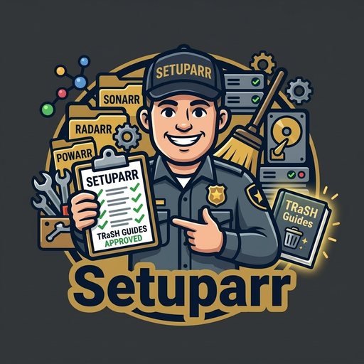

<p align="center"></p>

# Setuparr

Checks your Unraid media setup against the TRaSH guides and Unraid's own advice, then fixes what doesn't match with one button, or shows you how to fix it yourself.

It only reads from your apps. Nothing is changed until you press **Fix it**, and every fix can be undone from the
Dashboard.

## What it checks

Press **Run checks** on the Dashboard (they also run by themselves once a day). Each finding says what's wrong, why it
matters and how to fix it, with a link to the TRaSH guide. Some have a **Fix it** button. You can dismiss anything you've
decided to leave as it is.

### Your Unraid setup

From the Docker templates and share settings you give it on the **Unraid** page (see below):

- **Hardlinks and instant moves:** whether Sonarr and Radarr see downloads and your library through one mapping, as the
  TRaSH guide sets out, or copy every download.
- **Downloads they can't reach:** library apps whose mappings don't include any download client's folder.
- **Paths that don't match:** a download client saving to `/downloads` while Sonarr sees the same folder as
  `/data/torrents`, which needs a Remote Path Mapping.
- **`/mnt/user` mixed with a disk or pool path** for the same share, a known way to lose data.
- **PUID, PGID and UMASK** that differ between containers.
- **appdata or system shares** that can end up on the array, and downloads and media spread over several shares.
- **The mover filling your cache:** a downloads or media share set to move from the array to the cache.
- **Hard link support turned off** in Global Share Settings (Tunable (support Hard Links)), the TRaSH guide's first step.
- **appdata through the FUSE layer:** appdata reached through `/mnt/user` when it could be an exclusive share, which
  Unraid 6.12 added so containers skip the slower FUSE layer.
- **Where Docker lives:** `docker.img` or Docker's folder on the array, or Docker's folder going through the FUSE layer,
  against Unraid's own advice on Settings > Docker.
- **macvlan with bridging on** when containers have their own IP address, which Unraid's 6.12.4 release notes say
  crashes the server on 6.12.10 and earlier.
- **Ports:** two containers mapped to the same host port, or a container on the port Unraid's own web UI uses.
- **Start order:** a container that goes through another container's network (qBittorrent through Gluetun) but starts
  before it, or starts when the other doesn't, and media containers that don't start by themselves.
- **Docker's log rotation** turned off, so logs can fill docker.img.
- **Disks:** a disk that's disabled, emulated, missing or unmountable, read or write errors, no parity drive, no
  scheduled parity check, and a pool or the flash drive over 90% full.
- **Alerts** only shown in the web UI, so a failed disk goes unnoticed.
- **Time:** NTP turned off, and containers on a different time zone from Unraid.
- **appdata shared over SMB** as Public or Secure, so anyone on your network can read your API keys.
- **The mover:** running every hour, a downloads or media share with no minimum free space, or one that never leaves
  the cache.
- **Appdata Backup:** no schedule, no destination, backups on the same pool as appdata, the flash drive not backed up,
  and media containers skipped.

### Plugins and hardware

From the plugins and PCI IDs the terminal command sends:

- Plugins and containers that Community Applications' moderators have **deprecated or blacklisted**, the same list Fix
  Common Problems uses. Setuparr downloads it from GitHub once a day.
- **Fix Common Problems** or **Appdata Backup** not installed, and plugins made for a different Unraid version.
- An **Nvidia, Intel or AMD GPU** without its driver plugin (Nvidia Driver, Intel GPU TOP, Radeon TOP), **Plex,
  Jellyfin or Emby not given the GPU**, so every transcode runs on the CPU, and containers given a GPU the server
  doesn't have.
- A **Realtek RTL8125, RTL8126 or RTL8168** network card on Unraid's built-in driver, and a **Coral** accelerator with
  no driver.

### Download clients (Sonarr, Radarr, qBittorrent, Transmission, Deluge)

From Sonarr and Radarr's download client settings:

- Completed Download Handling turned off, so nothing gets imported.
- Download clients reached at `localhost`, which inside a container is the container itself.
- Download clients with no category, and Sonarr and Radarr sharing one category in the same client.
- Deluge used with a category while its Label plugin is off.

When you connect qBittorrent, Transmission or Deluge under **Settings** (Setuparr only reads their settings):

- Downloads saved to a folder that isn't in the client's folder mappings, so they stay inside the container (needs
  your Unraid settings).
- Unfinished downloads kept in a different folder mapping, so every finished download is copied.
- qBittorrent: categories that don't choose the folder (Manual torrent management), pre-allocation on a cached share,
  and networks let in without a password.

### Library (Sonarr, Radarr)

- Root folders Sonarr or Radarr can't reach.
- Use Hardlinks instead of Copy turned off.
- Propers and Repacks not set to Do Not Prefer when you use the TRaSH Repack/Proper custom format.
- Rename Episodes or Rename Movies turned off.

### Tags (Sonarr, Radarr, Prowlarr, Seerr)

- Tags nothing uses (**Fix it** deletes them).
- Indexers, download clients and profiles limited to a tag no series or film has, so they're never used.
- Every indexer or download client tagged, leaving untagged series or films with none.
- Tags that look like the same thing, such as `4k` and `4-k`.
- Prowlarr: FlareSolverr with no tag or no indexer sharing its tag, and apps that get no indexers because of their tags.
- Seerr: tags it adds to requests that were deleted in Sonarr or Radarr.

### Anime (Sonarr, Seerr)

- Series TVDB calls anime that aren't set to the Anime series type (**Fix it** sets them), Japanese animation that may be
  anime, and normal shows set to Anime.
- Anime outside your anime root folder or quality profile, and other shows inside them.
- An anime episode format without the absolute episode number.
- Indexers with no anime categories.
- Seerr with no anime root folder or profile, so requested anime lands in your TV setup.

### Coming next

- TRaSH guide custom formats, quality profiles, sizes and naming, Prowlarr sync, Jellyfin and Plex settings.
- SABnzbd and NZBGet folders and categories.
- Your own genre rules (Kids, Documentaries, Stand-up…) and what doesn't follow them.
- More **Fix it** buttons, including for download client settings, and anime checks for Radarr.

## Giving Setuparr your Unraid settings

Setuparr never looks around your server and doesn't need the Docker socket. It reads only the Unraid settings files
you send it: the Docker templates, the share settings and Compose Manager's compose files.

It also reads Unraid's `docker.cfg`, `share.cfg`, `network.cfg`, `ident.cfg` and `plugins/dynamix/dynamix.cfg`, the
installed plugins' `.plg` files and Appdata Backup's settings. The terminal command adds your Unraid version, the PCI
IDs from `lspci -n` (numbers like `0300:8086:4680`, which say what kind of GPU and network card you have), the state of
your disks (`/var/local/emhttp/disks.ini`) and the order containers start in (`/var/lib/docker/unraid-autostart`).

**Passwords, API keys and personal details are removed.** The files are read in memory, and only what the checks need
is kept: each container's name, image, folder mappings and host ports, its PUID, PGID and UMASK, whether it's given a
GPU or its own IP address, which container's network it uses, and whether its time zone matches Unraid's; the few
Unraid settings the checks look at; each disk's slot (like disk1), state, size, free space and error count; each
plugin's file name, the address it was installed from and the Unraid versions it's made for; and Appdata Backup's
schedule, destination and skipped containers. Everything else (passwords, API keys, VPN details, email settings, IP
addresses, disk serial numbers, the server's name, other settings, network names and time zones) is dropped as the
files are read and never saved. Folder and container names are kept because the checks need them, so if one is named after a person, that name
is kept too.

**From Unraid's terminal (easiest).** On Setuparr's **Unraid** page, press **Get the command** and copy it. In Unraid,
click the `>_` icon at the top right, paste it and press Enter. It packs the files and sends them straight to
Setuparr, so nothing is written to disk on the way. The command works once, for 15 minutes, and the page updates by
itself when the files arrive.

**Or choose the files.** Export the flash share over SMB (read-only is fine), open `\\tower\flash\config`, and
choose the `plugins\dockerMan\templates-user` and `shares` folders, or a zip of them. Add `docker.cfg`, `share.cfg`,
`network.cfg`, `ident.cfg`, `plugins\dynamix\dynamix.cfg`, the `plugins\appdata.backup` folder and the `.plg` files in
`plugins` for the Docker, share, time, alert, backup and plugin checks. Only those files are sent, from your browser to
Setuparr. The disk, start order, GPU, network card and Unraid version checks need the terminal command.

Unraid keeps templates for containers you've removed, so untick those on the Unraid page or they're checked too. Send
the files again whenever you change a container.

If you used Setuparr 0.2.0's instructions, an `unraid-config.tar.gz` may still be in Setuparr's config folder. The
Unraid page offers to read it and delete it, or just delete it.

## Install on Unraid

1. Add the template from [`unraid/setuparr.xml`](unraid/setuparr.xml), or search Community Apps for Setuparr.
2. Keep the **Config** folder at `/mnt/user/appdata/setuparr`.
3. Start it, open the web UI (port 9893), and create your login with the setup code from the container's log.
4. Add your apps and download clients under **Settings** (addresses start with `http://`) and press **Test connection**
   on each.
5. Give it your Unraid settings on the **Unraid** page, then press **Run checks** on the Dashboard.

## Install with Docker

```bash
docker run -d --name setuparr \
  -p 9893:9893 \
  -v /path/to/appdata/setuparr:/config \
  ghcr.io/p1zzm1ssile/setuparr:latest
```

Or with Docker Compose:

```yaml
services:
  setuparr:
    image: ghcr.io/p1zzm1ssile/setuparr:latest
    container_name: setuparr
    ports:
      - 9893:9893
    volumes:
      - ./setuparr:/config
    restart: unless-stopped
```

Every setting is in the web UI. To pre-fill them on first start, see `.env.tmpl` for the environment variables.

## First run

1. Open `http://your-server:9893`.
2. Enter the **setup code** from Setuparr's log. It's printed when Setuparr starts (in Unraid, click the Setuparr icon and
   choose **Logs**; with Docker, run `docker logs setuparr`). This stops anyone else on your network, or anyone reaching
   it through a misconfigured proxy, from creating the account before you.
3. Create your login. The password needs at least 8 characters, with an uppercase letter, a lowercase letter, a number
   and a special character.

## Login and security

> ⚠️ **Keep Setuparr on your home network.** It can change the settings of Sonarr, Radarr, Prowlarr and Seerr and holds their API keys and your download clients' passwords. We don't recommend putting it behind a reverse proxy
> (Nginx Proxy Manager, SWAG, Traefik, Cloudflare Tunnel and the like) for access from outside your network. To reach
> it remotely, use a VPN such as WireGuard or Tailscale.

- The password is stored as a scrypt hash in `/config/auth.json`, never in plain text.
- After 5 wrong passwords, that address is locked out for 5 minutes.
- **Skip login on my local network** (Settings > General) lets devices on the networks you list in without a password.
  It never applies to requests that arrive through a reverse proxy.
- Changing an app's address needs its API key entered again, so a saved key can't be sent somewhere new.
- Saved API keys and passwords are never sent back to the browser, and `settings.json` and `auth.json` are only readable by the
  account Setuparr runs as.
- **Forgotten your password?** Delete `auth.json` from the config folder and restart Setuparr. It will ask you to create
  a login again, with a new setup code in the log. Your settings are kept.

## Health check

- **HTTP:** `GET /health` returns the status as JSON, with HTTP 200 when healthy and 503 when not.
- **Command line:** `docker exec setuparr python healthcheck.py` exits with 0 when healthy, 1 when not.
- **Docker:** the image includes a `HEALTHCHECK`, so `docker ps` shows `healthy` or `unhealthy`.

## Free forever

Every feature in Setuparr is free and always will be. There are no paid tiers, no Pro account, no subscriptions and no telemetry, and new features will be free too. Services Setuparr works with, like Sonarr, Radarr, Prowlarr, Seerr, Jellyfin and Plex, have their own terms.

## About the developer

I'm an ISO 27001 Lead Auditor with combined-type ADHD, dyslexia and dyscalculia. I can read code and follow its logic and security well, but writing it out myself isn't possible. So I design what Setuparr does and how it works, and use AI as an assistive tool to write the code from that design. I review and test every change before it's released.

## Contact

Bugs and ideas: [open an issue](https://github.com/p1zzm1ssile/Setuparr/issues/new?title=%5BSetuparr%5D%20). For anything
private, email [p1zzm1ssilerepo@gmail.com](mailto:p1zzm1ssilerepo@gmail.com?subject=Setuparr). Both are also on the Contact page in the web UI.

## Licence

MIT. See [LICENSE](LICENSE).
